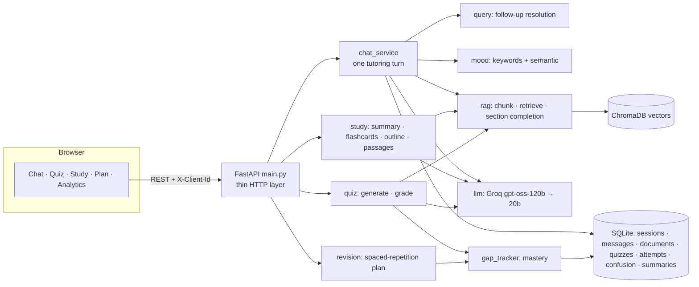

# MentoraAI — architecture

## One chat turn
1. Load the saved conversation for this session (before storing the new message, so it is never duplicated).
2. Detect mood (presentation only — it never changes facts or the subject).
3. **Resolve the question**: "What are its advantages?" becomes "What are the advantages of process scheduling?" (LLM rewrite, with a deterministic fallback that anchors to the active topic). A bare "I don't understand it" means the *topic*, not the last detail.
4. **Retrieve** from this owner's notes with true cosine similarity; broad questions ("all types…") get whole sections.
5. Build the prompt: fixed grounding rules + mood presentation + clarification mode when the student is stuck.
6. Call the model; on success store the exchange atomically; record an explicit "I don't understand" as a separate signal.

## Design rules that keep it trustworthy
* Facts come from the notes; when the notes do not cover something the tutor says so once and labels general knowledge.
* Mastery comes **only** from graded quiz answers. Mood and plain questions never mark a topic weak.
* A model outage never creates a false result: failed grading/summaries are not stored.
* Every study feature uses "only the text given" prompts and shows where the content came from (click a source to read the section).
